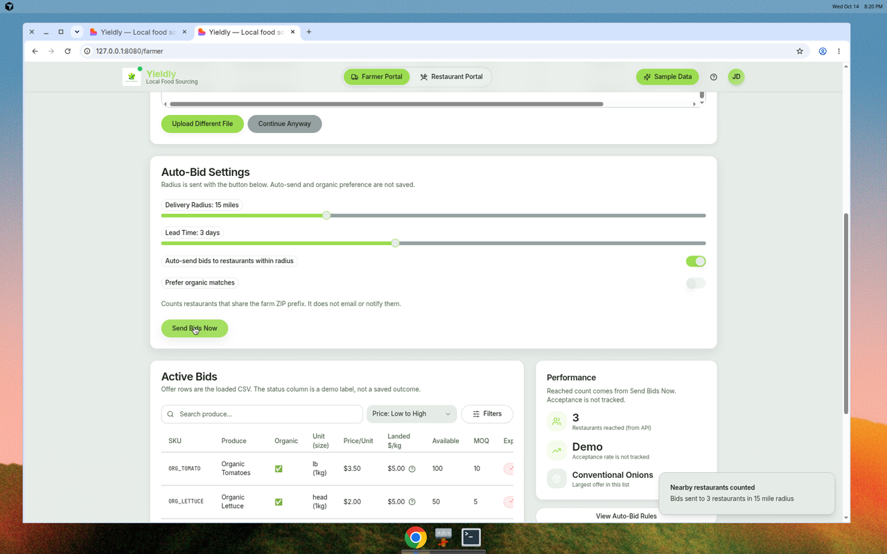
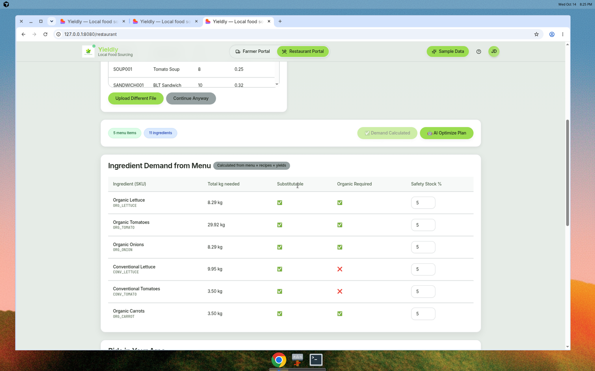
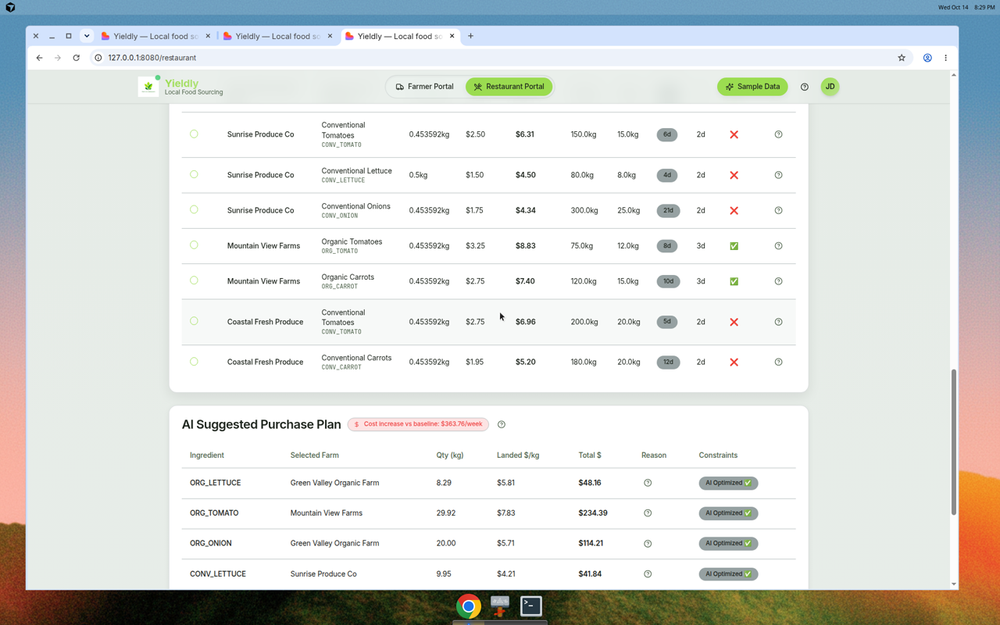

# Yieldly

Yieldly is a hackathon app that connects farmers selling produce with restaurants buying it. A farmer lists offers. A restaurant loads a menu and recipes, looks at nearby bids, and gets a purchase plan plus suggested menu prices.

There is no deployed site. The screenshots below are from a local run on 14 October 2026.

Git history has one author, [Krishiv Seth](mailto:krishivseth05@gmail.com): the initial commit and the commit that brought the frontend into this repo. No other teammates show up in the log.

## Screenshots

Farmer portal after the sample CSV loads. Organic Tomatoes show a landed cost of **$5.00/kg** (`delivery_fee` of $15 spread over the minimum order). **Send Bids Now** asked the API how many restaurants share farm `FARM001`'s ZIP prefix; the card shows **3**. Acceptance is labeled demo because bid outcomes are not stored. The largest row in this CSV is Conventional Onions.



Restaurant demand for the sample menu, including 5% safety stock. Organic Lettuce is **8.29 kg**. Organic Carrots are on the list because the on-screen CSV includes them.



The purchase plan uses those same rows. The badge says **Cost increase vs baseline: $363.76/week** because minimum order quantities buy more than the menu needs, so `savings_vs_baseline` is negative. Lettuce in the plan is 8.29 kg, the same figure as the demand table. Onion and carrot quantities are higher because of minimum orders.



## What the app actually does

`/` redirects to `/farmer`. Unknown paths render a not-found page.

**Farmer portal** (`/farmer`)

- Upload a produce CSV. With `GEMINI_API_KEY` set, column mapping can use Gemini. Without it, mapping is substring matching on the headers.
- **Sample Data** loads the database seed and then shows `farmer_offers.csv` in the table.
- **Send Bids Now** calls `POST /farmer/send_bids_now` with the radius slider and farm id `FARM001` (or a `farm_id` on the loaded rows). The API counts restaurants that share that farm's ZIP prefix. It does not email anyone. The performance card shows that count. Acceptance rate is labeled demo. The third line is the largest offer in the loaded list.
- Auto-send and the organic preference switch are not saved. **View Auto-Bid Rules** saves nothing and says the rule was created in demo mode. The status column is labeled demo.

**Restaurant portal** (`/restaurant`)

- **Sample Data** loads the database seed, then shows `restaurant_menu.csv` (5 menu items) and `restaurant_ingredients.csv` (11 ingredients) in the page.
- **Calculate Weekly Demand** calls `POST /restaurant/weekly_demand` with the menu and ingredients on screen, including 5% safety stock.
- **Bids in Your Area** calls `GET /restaurant/bids` for restaurant id `1`.
- **AI Optimize Plan** calls `POST /restaurant/optimize_plan` with those same menu rows. Without a Gemini key, the explanation is the built-in fallback sentence. If the plan costs more than the unconstrained baseline, the badge says cost increase instead of savings. Accepting the plan repeats that same figure.
- Purchase-order and price-change export buttons call the export endpoints and download a CSV.
- The market-intelligence panel calls `POST /restaurant/analyze_market_trends`. Without `BRAVE_SEARCH_API_KEY`, that service uses its built-in stand-in figures.

Weekly demand and the purchase plan both start from the menu on screen. A plan quantity can still be higher than that demand when a farm's minimum order is larger than the menu needs. Offers themselves still come from the SQLite seed, whose expiry dates are relative to today. The farmer table is the CSV, whose expiry dates are January 2024.

## Setup

You need Python 3.12 (3.11+ should work) and Node.js with npm. This repo was checked with Python 3.12.3 and Node 22.

```bash
git clone <your-fork-url>
cd <repo>

python3 -m venv .venv
source .venv/bin/activate
pip install -r backend/requirements.txt
python backend/start.py
```

In a second terminal:

```bash
cd frontend
npm install
npm run dev
```

Open [http://localhost:8080](http://localhost:8080). The API docs are at [http://localhost:8000/docs](http://localhost:8000/docs).

`start.py` listens on port **8000** unless `PORT` is set. The frontend calls `VITE_API_BASE_URL`, or `http://localhost:8000` when that variable is unset. Both sides used to disagree (`start.py` on 8000, `frontend/src/services/api.ts` hardcoded 8001).

Optional settings live in a gitignored `.env`. Copy the names from [`.env.example`](.env.example) and fill them in locally. Do not commit secrets. The API reads a repo-root `.env`, then `backend/.env` (the backend file wins). Vite is configured to read the repo-root `.env` as well, and only variables prefixed with `VITE_` are exposed to the browser.

| Name | Role |
| --- | --- |
| `GEMINI_API_KEY` | Optional. Turns on Gemini matching and explanations. |
| `GEMINI_MODEL` | Optional. Defaults to `gemini-3.6-flash`. |
| `BRAVE_SEARCH_API_KEY` | Optional. Live web search for the market panel. |
| `DATABASE_URL` | Optional. Defaults to `sqlite:///./yieldly.db` in the backend working directory. |
| `PORT` | API port. Defaults to `8000`. |
| `VITE_API_BASE_URL` | Frontend API origin. Defaults to `http://localhost:8000`. |

The app starts with no Gemini key. `GET /llm/status` then returns `enabled: false`. If `google-generativeai` is not installed, import still succeeds and LLM features stay off.

`google-generativeai` remains in `backend/requirements.txt`, so a normal install includes it. The model id is `gemini-3.6-flash`, the replacement Google lists for the shut-down Gemini 2.0 Flash line (`gemini-2.0-flash-exp` was the previous id in this repo).

## Architecture

```text
browser  →  Vite / React / TypeScript / Tailwind / shadcn/ui   :8080
                frontend/src/services/api.ts
                    │  VITE_API_BASE_URL (default http://localhost:8000)
                    ▼
            FastAPI  ·  SQLAlchemy  ·  SQLite                     :8000
                backend/app/main.py
                demand, offers, greedy purchase plan, price nudges, CSV export
                optional Gemini (google.generativeai) and Brave Search
```

| Piece | Where |
| --- | --- |
| Farmer and restaurant screens | `frontend/src/pages/` |
| API client | `frontend/src/services/api.ts` |
| HTTP routes | `backend/app/main.py` |
| Tables | `backend/app/models.py` |
| Sample database seed | `POST /dev/load_sample_data` → `backend/app/sample_data.py` (expiry dates relative to today) |
| Sample CSV files the UI displays | `backend/sample_csvs/` |
| Console encoding helper | `backend/app/console.py` (emoji status lines no longer crash a cp1252 Windows console) |

CORS allows `http://localhost:8080` and `http://127.0.0.1:8080`.

### API

| Method | Path | What it does |
| --- | --- | --- |
| `GET` | `/healthz` | Health check |
| `GET` | `/llm/status` | Whether Gemini is enabled |
| `POST` | `/dev/load_sample_data` | Replace SQLite rows with the seed |
| `GET` | `/dev/sample_csvs/{filename}` | Download a file from `backend/sample_csvs/` |
| `POST` | `/farmer/process_data` | Map and parse a farmer CSV payload |
| `POST` | `/farmer/send_bids_now` | Count restaurants that share the farm ZIP prefix. Does not notify them. |
| `POST` | `/restaurant/process_data` | Map and parse a restaurant CSV payload |
| `POST` | `/restaurant/weekly_demand` | Kg by SKU for the menu rows in the request |
| `GET` | `/restaurant/bids` | Feasible offers for a restaurant |
| `POST` | `/restaurant/optimize_plan` | Greedy purchase plan. Uses menu rows in the body when they are sent. |
| `POST` | `/restaurant/export_po` | Purchase-order CSV |
| `POST` | `/restaurant/export_price_changes` | Price-change CSV |
| `POST` | `/restaurant/analyze_market_trends` | Market panel data |

More detail on CSV columns is in [`backend/README.md`](backend/README.md).

## Tests run

From `backend/`, with dependencies installed and `GEMINI_API_KEY` unset:

| Check | Result |
| --- | --- |
| `python test_core.py` | **5 of 5 passed.** Imports, unit conversions, optimization, on-screen demand, and pricing. |
| Import `app.main` with no API key | Server object loads. LLM `enabled` is false. Configured model name is `gemini-3.6-flash`. |
| Import while blocking `google.generativeai` | Does not raise. LLM stays disabled. |
| Print emoji to a strict cp1252 stdout | Raises `UnicodeEncodeError` before `configure_stdio()`, prints replacement characters after it. |
| `uvicorn` on port 8000, no Gemini key | `GET /healthz` healthy. `GET /llm/status` reports the key is not configured. `POST /dev/load_sample_data`, `GET /restaurant/bids?restaurant_id=1`, and `POST /restaurant/optimize_plan` returned 200. |
| `npm run build` in `frontend/` | Succeeds (`yieldly@0.0.0`). Vite warns that the JS chunk is over 500 kB. |
| Browser at `http://127.0.0.1:8080` | Farmer landed cost for Organic Tomatoes was $5.00. Send Bids Now showed 3 restaurants. Demand listed Organic Lettuce at 8.29 kg and Organic Carrots. The plan badge said cost increase of $363.76/week and included carrots. No Gemini key. |

## Known issues

- `backend/sample_csvs/farmer_offers.csv` expiry dates are January 2024, so the farmer expiry badges count backward from those dates. The bid list uses the database seed, whose dates are relative to today.
- The farmer table treats `unit_size` as kilograms. The sample file's unit is `lb` with `unit_size` 1, and the cell is labeled `lb (1kg)`. Landed $/kg uses that 1 kg figure.
- **Send Bids Now** with no `farm_id` on the row uses `FARM001`. Auto-send, organic preference, the “JD” avatar, and auto-bid rules are still not saved.
- Purchase-order export still rebuilds a plan from the SQLite seed, not from the on-screen menu.
- Upload templates point at `/templates/...`, and those files are not in `frontend/public`.
- There is no authentication. The restaurant screen always uses restaurant id `1`.
- The help button does nothing.
- `npm audit` reports existing dependency advisories. They were not changed here.
- `sqlalchemy.ext.declarative.declarative_base` is the older import still used in `backend/app/models.py`.

## Next steps

- Refresh the sample farmer CSV dates, and convert `lb` to kilograms in the farmer table.
- Point purchase-order export at the plan the page just accepted.
- Persist auto-bid rules, or remove the controls that do not save.
- Add auth before anyone treats this as more than a local demo.
