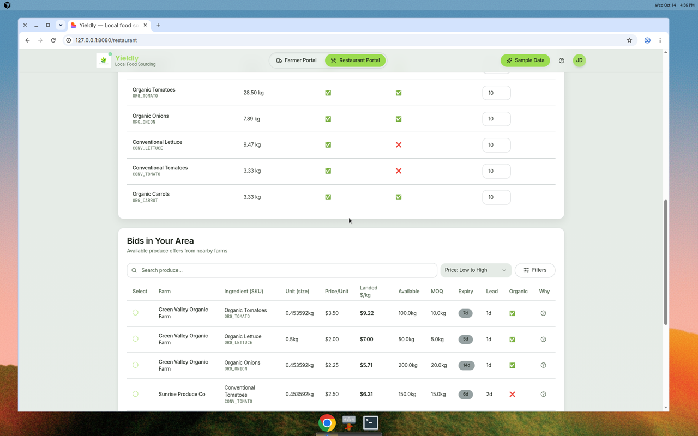

# Yieldly

Yieldly is a hackathon app that connects farmers selling produce with restaurants buying it. A farmer lists offers. A restaurant loads a menu and recipes, looks at nearby bids, and gets a purchase plan plus suggested menu prices.

There is no deployed site. The screenshots below are from a local run on 14 October 2026.

Git history has one author, [Krishiv Seth](mailto:krishivseth05@gmail.com): the initial commit and the commit that brought the frontend into this repo. No other teammates show up in the log.

## Screenshots

Farmer portal after **Sample Data**. The offer rows are parsed in the browser from `backend/sample_csvs/farmer_offers.csv`. The performance card (14 restaurants, 32% acceptance, top SKU) is hardcoded placeholder copy.


Restaurant portal after **Sample Data**, **Calculate Weekly Demand**, and **AI Optimize Plan**. The bids and the purchase plan are responses from the API on port 8000. The green badge reads “Savings vs baseline: $79.42/week”. On this same sample, `POST /restaurant/optimize_plan` returned `savings_vs_baseline` of about **-79.42**: the constrained plan cost more than the unconstrained baseline, and the UI prints `Math.abs`. See [Known issues](#known-issues).




## What the app actually does

`/` redirects to `/farmer`. Unknown paths render a not-found page.

**Farmer portal** (`/farmer`)

- Upload a produce CSV. With `GEMINI_API_KEY` set, column mapping can use Gemini. Without it, mapping is substring matching on the headers.
- **Sample Data** loads the database seed and then shows `farmer_offers.csv` in the table.
- Auto-bid radius, lead time, and organic preference are controls on the page. **Send Bids Now** only shows a toast. It does not call `POST /farmer/send_bids_now`.
- **View Auto-Bid Rules** saves nothing. The dialog says the rule was created in demo mode.

**Restaurant portal** (`/restaurant`)

- **Sample Data** loads the database seed, then shows `restaurant_menu.csv` (5 menu items) and `restaurant_ingredients.csv` (11 ingredients) in the page.
- **Calculate Weekly Demand** runs in the browser from those rows (recipe quantity × expected orders ÷ yield).
- **Bids in Your Area** calls `GET /restaurant/bids` for restaurant id `1`.
- **AI Optimize Plan** calls `POST /restaurant/optimize_plan`. Without a Gemini key, the explanation is the built-in fallback sentence, not a model response.
- Purchase-order and price-change export buttons call the export endpoints and download a CSV.
- The market-intelligence panel calls `POST /restaurant/analyze_market_trends`. Without `BRAVE_SEARCH_API_KEY`, that service uses its built-in stand-in figures.

The weekly demand table and the purchase plan are not the same calculation. Demand is computed in the browser from the sample CSVs. The optimizer reads SQLite for restaurant id `1`, which the seed fills with 3 menu items and 6 ingredients (Garden Salad, Caesar Salad, Tomato Soup). The sample CSVs also include a BLT and extra ingredients.

## Setup

You need Python 3.12 (3.11+ should work) and Node.js with npm. This repo was checked with Python 3.12.3 and Node 22.

```bash
git clone <your-fork-url>
cd <repo>

python3 -m venv .venv
source .venv/bin/activate
pip install -r backend/requirements.txt
python backend/start.py
```

In a second terminal:

```bash
cd frontend
npm install
npm run dev
```

Open [http://localhost:8080](http://localhost:8080). The API docs are at [http://localhost:8000/docs](http://localhost:8000/docs).

`start.py` listens on port **8000** unless `PORT` is set. The frontend calls `VITE_API_BASE_URL`, or `http://localhost:8000` when that variable is unset. Both sides used to disagree (`start.py` on 8000, `frontend/src/services/api.ts` hardcoded 8001).

Optional settings live in a gitignored `.env`. Copy the names from [`.env.example`](.env.example) and fill them in locally. Do not commit secrets. The API reads a repo-root `.env`, then `backend/.env` (the backend file wins). Vite is configured to read the repo-root `.env` as well, and only variables prefixed with `VITE_` are exposed to the browser.

| Name | Role |
| --- | --- |
| `GEMINI_API_KEY` | Optional. Turns on Gemini matching and explanations. |
| `GEMINI_MODEL` | Optional. Defaults to `gemini-3.6-flash`. |
| `BRAVE_SEARCH_API_KEY` | Optional. Live web search for the market panel. |
| `DATABASE_URL` | Optional. Defaults to `sqlite:///./yieldly.db` in the backend working directory. |
| `PORT` | API port. Defaults to `8000`. |
| `VITE_API_BASE_URL` | Frontend API origin. Defaults to `http://localhost:8000`. |

The app starts with no Gemini key. `GET /llm/status` then returns `enabled: false`. If `google-generativeai` is not installed, import still succeeds and LLM features stay off.

`google-generativeai` remains in `backend/requirements.txt`, so a normal install includes it. The model id is `gemini-3.6-flash`, the replacement Google lists for the shut-down Gemini 2.0 Flash line (`gemini-2.0-flash-exp` was the previous id in this repo).

## Architecture

```text
browser  →  Vite / React / TypeScript / Tailwind / shadcn/ui   :8080
                frontend/src/services/api.ts
                    │  VITE_API_BASE_URL (default http://localhost:8000)
                    ▼
            FastAPI  ·  SQLAlchemy  ·  SQLite                     :8000
                backend/app/main.py
                demand, offers, greedy purchase plan, price nudges, CSV export
                optional Gemini (google.generativeai) and Brave Search
```

| Piece | Where |
| --- | --- |
| Farmer and restaurant screens | `frontend/src/pages/` |
| API client | `frontend/src/services/api.ts` |
| HTTP routes | `backend/app/main.py` |
| Tables | `backend/app/models.py` |
| Sample database seed | `POST /dev/load_sample_data` → `backend/app/sample_data.py` (expiry dates relative to today) |
| Sample CSV files the UI displays | `backend/sample_csvs/` |
| Console encoding helper | `backend/app/console.py` (emoji status lines no longer crash a cp1252 Windows console) |

CORS allows `http://localhost:8080` and `http://127.0.0.1:8080`.

### API

| Method | Path | What it does |
| --- | --- | --- |
| `GET` | `/healthz` | Health check |
| `GET` | `/llm/status` | Whether Gemini is enabled |
| `POST` | `/dev/load_sample_data` | Replace SQLite rows with the seed |
| `GET` | `/dev/sample_csvs/{filename}` | Download a file from `backend/sample_csvs/` |
| `POST` | `/farmer/process_data` | Map and parse a farmer CSV payload |
| `POST` | `/farmer/send_bids_now` | Count restaurants and return a simulated “bids sent” message |
| `POST` | `/restaurant/process_data` | Map and parse a restaurant CSV payload |
| `GET` | `/restaurant/bids` | Feasible offers for a restaurant |
| `POST` | `/restaurant/optimize_plan` | Greedy purchase plan and menu price nudges |
| `POST` | `/restaurant/export_po` | Purchase-order CSV |
| `POST` | `/restaurant/export_price_changes` | Price-change CSV |
| `POST` | `/restaurant/analyze_market_trends` | Market panel data |

More detail on CSV columns is in [`backend/README.md`](backend/README.md).

## Tests run

From `backend/`, with dependencies installed and `GEMINI_API_KEY` unset:

| Check | Result |
| --- | --- |
| `python test_core.py` | **2 of 4 passed.** Optimization and pricing passed. Import and unit-conversion tests still load `app.services.parsing`, which is not in the tree. |
| Import `app.main` with no API key | Server object loads. LLM `enabled` is false. Configured model name is `gemini-3.6-flash`. |
| Import while blocking `google.generativeai` | Does not raise. LLM stays disabled. |
| Print emoji to a strict cp1252 stdout | Raises `UnicodeEncodeError` before `configure_stdio()`, prints replacement characters after it. |
| `uvicorn` on port 8000, no Gemini key | `GET /healthz` healthy. `GET /llm/status` reports the key is not configured. `POST /dev/load_sample_data`, `GET /restaurant/bids?restaurant_id=1`, and `POST /restaurant/optimize_plan` returned 200. |
| `npm run build` in `frontend/` | Succeeds (`yieldly@0.0.0`). Vite warns that the JS chunk is over 500 kB. |
| Browser at `http://127.0.0.1:8080` | Sample Data, weekly demand, bids (Green Valley Organic Farm and others), and a purchase plan all rendered. The API log showed those calls on port 8000. |

## Known issues

- `backend/test_core.py` still imports the removed `app.services.parsing` module, so two tests fail.
- Farmer **Send Bids Now**, the performance card, the “JD” avatar, and the auto-bid rule dialog are demo UI. They are not backed by saved data.
- Accepting a purchase plan toasts a hardcoded “You're saving $412/week”, which is not the plan total.
- The savings badge uses `Math.abs`. A negative `savings_vs_baseline` (the sample plan) is shown as money saved.
- `backend/sample_csvs/farmer_offers.csv` uses January 2024 expiry dates and a `delivery_fee` column. The farmer table’s landed $/kg reads `delivery_fee_flat`, so those cells stay `$0.00`. The database seed uses dates relative to today and is what the bids endpoint returns.
- The restaurant page’s demand table is the CSV. The optimizer uses the smaller SQLite seed for restaurant id `1`.
- Upload templates point at `/templates/...`, and those files are not in `frontend/public`.
- There is no authentication. The restaurant screen always uses restaurant id `1`.
- The help button does nothing.
- `npm audit` reports existing dependency advisories. They were not changed here.
- `sqlalchemy.ext.declarative.declarative_base` is the older import still used in `backend/app/models.py`.

## Next steps

- Call `POST /farmer/send_bids_now` from **Send Bids Now**, and replace the hardcoded performance numbers.
- Show the sign of `savings_vs_baseline` instead of the absolute value, and use the real plan delta in the accept toast.
- Make weekly demand and optimize read the same rows (either send the on-screen menu to the API, or render the seed).
- Map `delivery_fee` in the sample farmer CSV, and refresh those expiry dates.
- Point `test_core.py` at the services that exist now.
- Add auth before anyone treats this as more than a local demo.
